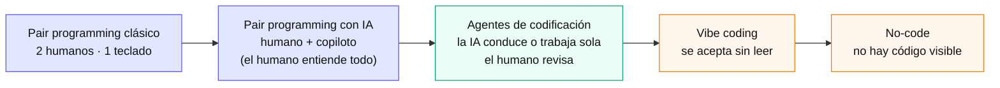

# 2. Relación entre los temas y matrices de análisis

**Abreviaturas de las columnas:**
**PP** = Pair programming clásico · **PP-IA** = Pair programming con IA (copilotos) · **AG** = Agentes de IA de codificación · **VC** = Vibe coding · **NC** = No-code / low-code

**Escala:** ✅ favorece / fortalece · ⚠️ depende de la disciplina (riesgo si no se controla) · ❌ tiende a debilitar · ➖ no aplica o neutro

---

## 2.1 Cómo se relacionan los temas

Los cinco temas son puntos de un mismo espectro: **cuánto código escribe el humano y cuánto entiende de lo que entra al sistema.**

| Relación | Explicación |
|---|---|
| **PP → PP-IA** | El pair programming con IA **hereda** los roles driver/navigator y sus beneficios (revisión continua, diseño compartido). Cambia el compañero: la IA no se cansa, pero no rinde cuentas ni conoce el negocio. |
| **PP-IA → AG** | El agente es la tecnología que permite que la IA **cambie de rol**: de navegante (sugiere) a conductora (edita y ejecuta). Cuanta más autonomía, más importa que el humano sea un buen *navigator*: objetivos claros, pruebas, revisión. |
| **AG → VC** | El vibe coding usa los mismos agentes, pero **abandona el rol de navegante**: no se revisa ni se entiende. Misma herramienta, postura distinta. |
| **VC ↔ NC** | Comparten público (personas no programadoras) y objetivo (resultado rápido). El no-code esconde el código detrás de componentes visuales. El vibe coding lo genera pero no lo mira. Con los "AI app builders" las fronteras se borran. |
| **Todos ↔ Kairos** | El ejemplo práctico **es** un sistema multiagente (Tema 3) **construido** con pair programming con IA (Tema 2). Además ilustra los riesgos del vibe coding: por eso tiene pruebas automatizadas, reglas para agentes (`AGENTS.md`) y revisión humana. |

---

## 2.2 ¿Qué tan común es el stack designado?

Hay dos "stacks": el **de trabajo** (herramientas de pair programming con IA) y el **del producto** (tecnologías con las que se construyó Kairos).

### a) Stack de pair programming con IA

| Indicador | Dato | Lectura |
|---|---|---|
| Uso de herramientas de IA en desarrollo | **84 %** de los encuestados las usa o planea usarlas (Stack Overflow 2025, frente a 76 % en 2024) | Práctica **mayoritaria** |
| Uso diario | **47 %** del total y **~51 %** de los profesionales las usa a diario (SO 2025) | Ya es parte del flujo cotidiano |
| Confianza | **33 %** confía en su precisión y **46 %** desconfía (SO 2025) | Se usa mucho, pero con escepticismo: justifica mantener al humano como navegante |
| GitHub Copilot | **20 millones** de usuarios acumulados (jul. 2025) y **4,7 millones** de suscriptores de pago (ene. 2026) | Herramienta dominante en empresas |
| Cursor | Ingresos anualizados superiores a **US$1.000 millones** a finales de 2025 y valoración de **US$29.300 millones** (nov. 2025) | El editor "AI-first" de más rápido crecimiento |

**Conclusión:** el pair programming con IA es **muy común**, el estándar de facto en 2025–2026. Lo poco común todavía es hacerlo **con disciplina**: reglas versionadas, TDD, revisión de diffs y métricas.

### b) Stack del producto Kairos

| Tecnología | Uso en Kairos | Qué tan común es |
|---|---|---|
| **Python 3.12** | Lenguaje de los agentes y de la API | Uno de los lenguajes más usados del mundo. Lenguaje principal de IA/ML. Creció con fuerza en SO 2025. |
| **FastAPI** | API REST del orquestador | Framework web de Python en fuerte crecimiento. Estándar para servir modelos y agentes. |
| **LangGraph** | Grafo de orquestación con estado compartido | Framework multiagente muy popular del ecosistema LangChain. Lo usan empresas como Klarna, Replit, Elastic y LinkedIn (*según LangChain*). Es nicho frente a Python/Docker, pero **líder en su categoría**. |
| **PostgreSQL 16** | Estado compartido (pizarra) | Base de datos más usada por desarrolladores en las encuestas de SO de 2023 a 2025 |
| **Docker / Docker Compose** | Empaquetado y despliegue | Prácticamente universal. SO 2025 reporta el mayor salto de uso entre todas las tecnologías. |
| **Nginx** | Servidor web y proxy inverso | Uno de los servidores web más desplegados |
| **HTML/CSS/JS sin framework** | Interfaz | Universal. Se eligió sin framework para que el foco sea la arquitectura. |
| **Ollama / Anthropic API** | LLM local u en la nube (opcional) | Ollama es la forma más popular de correr LLM locales. Las APIs de LLM ya son parte del stack de cualquier producto con IA. |

**Conclusión:** salvo LangGraph, que es especializado, todo el stack es **mainstream**. Es fácil de mantener, de contratar y de enseñar.

---

## 2.3 Matriz de análisis: Principios SOLID vs. temas

| Principio | PP | PP-IA | AG | VC | NC | Cómo se aplica en Kairos |
|---|---|---|---|---|---|---|
| **S** — Responsabilidad única | ✅ El navegante detecta clases que "hacen demasiado" | ⚠️ La IA tiende a generar funciones largas si no se le pide lo contrario. Las reglas del proyecto lo corrigen. | ✅ Diseñar **un agente = una responsabilidad** es el principio base de los sistemas multiagente | ❌ Archivos "dios" de cientos de líneas | ➖ La plataforma decide | Cinco agentes, cada uno con una sola tarea: `IntakeAgent` entiende, `PrioritizerAgent` puntúa, `SchedulerAgent` agenda, `MonitorAgent` vigila y `CoachAgent` acompaña |
| **O** — Abierto/cerrado | ✅ Se discute la extensión antes de modificar | ⚠️ La IA suele modificar en vez de extender; hay que guiarla | ✅ Añadir un agente o una herramienta no toca a los demás | ❌ Se reescribe lo que haga falta | ⚠️ Extensible solo por los puntos que da la plataforma | Agregar un agente = agregar un nodo al grafo (`graph.py`) sin tocar los existentes. Agregar un LLM = una nueva clase `LLMProvider`. |
| **L** — Sustitución de Liskov | ✅ | ⚠️ La IA puede romper contratos sutiles | ✅ Los agentes se intercambian si respetan el contrato | ❌ | ➖ | `NullProvider`, `OllamaProvider` y `AnthropicProvider` son intercambiables. El sistema funciona igual (con degradación) con cualquiera. |
| **I** — Segregación de interfaces | ✅ | ✅ La IA genera bien interfaces pequeñas si se le dan ejemplos | ✅ Cada agente recibe solo lo que necesita (tareas, hora) | ❌ | ➖ | Los agentes no conocen la BD ni HTTP: solo reciben `list[Task]` y `now` |
| **D** — Inversión de dependencias | ✅ | ⚠️ La IA tiende a instanciar dependencias concretas dentro de las funciones | ✅ Los agentes dependen de abstracciones (LLM, herramientas, MCP) | ❌ | ➖ | Los agentes dependen de `LLMProvider` (abstracción). La composición se hace en `main.py` (*composition root*). |

**Lectura:** SOLID **no se cumple solo** por usar IA. Se cumple cuando el humano, como navegante, lo **exige** (reglas en `AGENTS.md`, revisión). El vibe coding es el que más lo erosiona. El no-code lo delega a la plataforma.

---

## 2.4 Matriz de análisis: Atributos de calidad vs. temas

Atributos basados en ISO/IEC 25010 y Bass, Clements & Kazman (*Software Architecture in Practice*).

| Atributo | PP | PP-IA | AG | VC | NC | Táctica concreta en Kairos |
|---|---|---|---|---|---|---|
| **Mantenibilidad / modificabilidad** | ✅ Dos personas entienden el código | ✅/⚠️ Alta si se revisa; baja si se acepta sin leer | ⚠️ Cambios grandes difíciles de revisar | ❌ Nadie conoce el código | ⚠️ Atado a la plataforma | Capas (`api`, `orchestration`, `agents`, `domain`, `infrastructure`), dominio puro y agentes desacoplados |
| **Testabilidad** | ✅ TDD ping-pong | ✅ La IA genera pruebas rápido | ✅ El agente usa las pruebas para verificarse | ❌ Rara vez hay pruebas | ❌ Pruebas limitadas | Agentes como funciones puras: 26 pruebas sin BD ni LLM (`tests/`) y `FixedClock` |
| **Confiabilidad / disponibilidad** | ✅ | ⚠️ | ⚠️ Depende del proveedor del LLM | ❌ | ✅ La plataforma gestiona la infraestructura | **Degradación elegante**: si el LLM falla, se usan reglas. Reintentos al conectar a la BD. Health checks. `restart: unless-stopped`. |
| **Seguridad** | ✅ Cuatro ojos | ⚠️ Riesgo de código vulnerable o secretos en prompts | ⚠️ Permisos y *prompt injection* | ❌ Riesgo alto (datos expuestos) | ⚠️ Depende del proveedor | Usuario no-root en el contenedor, red `backend` aislada, secretos por variables de entorno, validación con Pydantic, HTML escapado en la UI |
| **Desempeño** | ➖ | ⚠️ El código de la IA puede ser ineficiente | ⚠️ Latencia y costo de tokens | ❌ | ⚠️ Techo de la plataforma | El LLM solo donde aporta (lenguaje). Las prioridades y la agenda son algoritmos deterministas O(n log n). |
| **Escalabilidad** | ➖ | ➖ | ✅ Agentes paralelizables | ❌ | ⚠️ | API sin estado; el estado vive en PostgreSQL; el monitor es un contenedor independiente |
| **Usabilidad** | ➖ | ✅ Mejora la experiencia del desarrollador | ✅ | ✅ Para el creador, ❌ para el mantenedor | ✅ | Entrada en lenguaje natural, explicación de cada decisión (`rationale`) y bitácora de agentes visible |
| **Interoperabilidad** | ➖ | ✅ | ✅ MCP, APIs | ⚠️ | ✅ Conectores | API REST con OpenAPI (`/docs`) y LLM intercambiable (Ollama / Anthropic) |
| **Portabilidad** | ➖ | ➖ | ➖ | ⚠️ | ❌ *Lock-in* | Docker Compose: corre igual en Windows, macOS y Linux |
| **Observabilidad / explicabilidad** | ✅ Se razona en voz alta | ✅ La IA explica sus sugerencias | ⚠️ Hay que registrar lo que hace el agente | ❌ | ⚠️ | Cada agente publica eventos (`agent_events`). La UI muestra qué agente decidió qué y por qué. |
| **Productividad del equipo** | ⚠️ Más horas-persona | ✅/⚠️ +55 % en tareas acotadas, −19 % en expertos sobre su propio código | ✅ En tareas mecánicas | ✅ Al inicio, ❌ después | ✅ | — |

---

## 2.5 Matriz de análisis: Tácticas de arquitectura vs. temas

Tácticas según Bass, Clements & Kazman. "Uso" indica qué tan presente está la táctica en cada práctica o herramienta.

| Atributo | Táctica | PP | PP-IA | AG | VC | NC | Dónde está en Kairos |
|---|---|---|---|---|---|---|---|
| Disponibilidad | **Degradación elegante** | ➖ | ✅ Copilot funciona aunque falle un modelo (multi-modelo) | ✅ *Fallback* de modelo | ➖ | ✅ | `IntakeAgent` y `CoachAgent` usan reglas si el LLM falla. Fallback del lado del servidor en Anthropic. |
| Disponibilidad | **Reintento** | ➖ | ✅ | ✅ El agente reintenta tras un error | ⚠️ "Arréglalo" en bucle | ✅ | `make_engine` reintenta 30 veces la conexión a PostgreSQL |
| Disponibilidad | **Monitoreo / heartbeat** | ➖ | ➖ | ✅ | ❌ | ✅ | `HEALTHCHECK` en los contenedores y el `MonitorAgent` como vigía periódico |
| Disponibilidad | **Excepciones controladas** | ✅ | ⚠️ | ✅ | ❌ | ✅ | El worker captura los errores por ciclo y no muere |
| Desempeño | **Introducir concurrencia** | ➖ | ➖ | ✅ Agentes en paralelo | ➖ | ➖ | API y monitor en procesos/contenedores separados |
| Desempeño | **Limitar demanda / priorizar** | ➖ | ⚠️ Costo de tokens | ✅ | ❌ | ✅ | LLM opcional y `effort: low` en las llamadas a Claude |
| Modificabilidad | **Encapsular / ocultar información** | ✅ | ⚠️ | ✅ | ❌ | ✅ | El dominio (`domain/`) no conoce la infraestructura |
| Modificabilidad | **Usar un intermediario** | ➖ | ➖ | ✅ Orquestador | ❌ | ✅ | `Orchestrator` (fachada) y nginx como proxy inverso |
| Modificabilidad | **Diferir el enlace (binding)** | ➖ | ✅ Elegir modelo en tiempo de ejecución | ✅ | ➖ | ✅ | `LLM_PROVIDER` por variable de entorno (Factory) |
| Modificabilidad | **Abstraer servicios comunes** | ✅ | ⚠️ | ✅ | ❌ | ✅ | `Agent` base, `LLMProvider` y `Repository` |
| Seguridad | **Limitar acceso / mínimo privilegio** | ➖ | ⚠️ | ✅ Permisos y sandbox del agente | ❌ | ✅ | Usuario `kairos` no-root y redes Docker separadas (`frontend` / `backend`) |
| Seguridad | **Validar entradas** | ✅ | ⚠️ | ✅ | ❌ | ✅ | Modelos Pydantic, esquema JSON estricto para la salida del LLM y escape de HTML |
| Seguridad | **Separar secretos** | ✅ | ⚠️ Riesgo de pegar llaves en el chat | ⚠️ | ❌ | ✅ | `ANTHROPIC_API_KEY` solo por entorno (`.env` en `.gitignore`) |
| Consistencia (integridad) | **Exclusión mutua** | ➖ | ➖ | ✅ | ❌ | ✅ | `pg_advisory_xact_lock` + Unidad de Trabajo: API y monitor no se pisan |
| Testabilidad | **Interfaces especializadas / sandbox** | ✅ | ✅ | ✅ | ❌ | ❌ | `FixedClock`, `NullProvider`, SQLite en memoria para pruebas de integración |
| Testabilidad | **Grabar / simular** | ➖ | ➖ | ➖ | ➖ | ➖ | Reloj con desfase (`/api/clock/advance`) para reproducir retrasos en la demo |
| Usabilidad | **Mantener el modelo del sistema visible** | ✅ Pensar en voz alta | ✅ | ⚠️ | ❌ | ✅ | Bitácora de agentes, `rationale` por tarea y marcas "en riesgo" / "reprogramada" |
| Usabilidad | **Apoyar la iniciativa del usuario** | ✅ | ✅ El humano acepta o rechaza | ✅ Aprobaciones | ❌ | ✅ | Iniciar, completar, eliminar y replanificar manualmente |

---

## 2.6 Matriz de análisis: Patrones vs. temas

| Patrón | Tipo | PP | PP-IA | AG | VC | NC | Uso en Kairos |
|---|---|---|---|---|---|---|---|
| **Driver / Navigator** | Colaboración | ✅ Núcleo | ✅ Núcleo (IA en un rol) | ✅ IA conductora | ❌ Se pierde el navegante | ➖ | Forma de trabajo del equipo (ver `04-pair-programming-ia.md`) |
| **Ping-pong (TDD)** | Colaboración | ✅ | ✅ Humano escribe la prueba, la IA implementa | ✅ | ❌ | ➖ | Pruebas en `tests/` escritas antes de cada agente |
| **Human-in-the-loop** | IA | ➖ | ✅ | ✅ Aprobación de diffs y PR | ❌ | ⚠️ | El usuario confirma iniciar, completar o replanificar. El equipo revisa cada cambio de la IA. |
| **Orquestador / Supervisor** | Multiagente | ➖ | ➖ | ✅ | ➖ | ✅ (flujos) | `Orchestrator` + `StateGraph` enruta: plan / replan / monitor |
| **Blackboard (pizarra)** | Arquitectura | ➖ | ➖ | ✅ Estado compartido entre agentes | ➖ | ✅ | `KairosState` dentro del grafo + PostgreSQL entre la API y el monitor |
| **Pipes & Filters** | Arquitectura | ➖ | ➖ | ✅ | ➖ | ✅ | `intake → prioritize → schedule → coach` |
| **ReAct / Plan-and-Execute** | Agente | ➖ | ✅ (agent mode) | ✅ | ✅ | ➖ | Ciclo del monitor: observar → detectar → replanificar |
| **Strategy** | GoF | ➖ | ✅ Selector de modelo | ✅ | ➖ | ➖ | `LLMProvider` (reglas / Ollama / Anthropic) |
| **Adapter** | GoF | ➖ | ✅ | ✅ MCP como adaptador universal | ➖ | ✅ Conectores | `OllamaProvider` y `AnthropicProvider` adaptan APIs externas |
| **Factory Method** | GoF | ➖ | ➖ | ➖ | ➖ | ➖ | `build_provider()` |
| **Null Object** | Diseño | ➖ | ➖ | ➖ | ➖ | ➖ | `NullProvider` fuerza el camino determinista sin `if llm is None` |
| **Facade** | GoF | ➖ | ➖ | ✅ | ➖ | ✅ | `Orchestrator` es la única puerta para la API y el worker |
| **Repository + Data Mapper** | DDD / PoEAA | ➖ | ⚠️ La IA tiende a mezclar SQL en controladores | ✅ | ❌ | ➖ | `Repository` traduce entre filas y `Task` |
| **Unit of Work** | PoEAA | ➖ | ➖ | ➖ | ❌ | ➖ | `_unit_of_work()`: transacción + bloqueo + reloj |
| **Composition Root / DI** | Diseño | ✅ | ⚠️ | ✅ | ❌ | ➖ | `main.build_orchestrator()` |
| **Retrieval-Augmented Generation (RAG)** | IA | ➖ | ✅ Indexación del repo | ✅ | ✅ | ✅ | No aplica (los datos están estructurados). Evolución posible: memoria de hábitos del usuario. |
| **Reflection / Self-critique** | Agente | ✅ (el navegante) | ✅ La IA revisa su propio código | ✅ | ⚠️ | ➖ | El `SchedulerAgent` revisa el riesgo de incumplimiento después de agendar |

---

## 2.7 Matriz de análisis: Mercado laboral vs. temas

| Dimensión | PP | PP-IA | AG | VC | NC |
|---|---|---|---|---|---|
| **Demanda (2025–2026)** | Estable. Valorada en empresas ágiles y consultoras | **Muy alta**: se da por hecho en ofertas de desarrollo. Shopify declaró en 2025 que el uso de IA es una expectativa base. | **Creciente**: roles de *AI engineer* y *agentic engineer*, automatización interna | Alta en startups y prototipado; **no es un rol**, es una habilidad | Estable–alta en negocio (analistas, automatización) |
| **Roles típicos** | Desarrollador, coach ágil, tech lead | Desarrollador de software (todos los niveles), QA, DevOps | AI engineer, ML/LLM engineer, platform engineer, ingeniero de herramientas internas | Fundador, product manager, diseñador, *maker* | Desarrollador ciudadano, consultor Power Platform / OutSystems / Mendix, analista de automatización |
| **Habilidades clave** | Comunicación, TDD, diseño | Revisión de código, *prompting* técnico, contexto (reglas), pruebas, seguridad | Diseño de agentes, herramientas/MCP, evaluación (evals), orquestación (LangGraph), costos | Prompting, criterio de producto | Modelado de procesos, integración, gobierno |
| **Certificaciones / señales** | Experiencia en XP/Scrum | GitHub Copilot certification (GitHub/Microsoft), portafolio | Cursos de proveedores (Anthropic, OpenAI, Google, DeepLearning.AI), proyectos en GitHub | Productos lanzados | PL-100/PL-200 (Microsoft), certificaciones OutSystems / Mendix |
| **Riesgo para juniors** | Bajo: es la mejor forma de aprender | **Medio**: la IA resuelve tareas junior, pero exige saber revisar | Alto si no se dominan los fundamentos | Alto: no construye fundamentos | Medio |
| **Evidencia** | — | SO 2025: 84 % usa o planea usar IA. WEF *Future of Jobs 2025*: IA y big data son las habilidades de más rápido crecimiento. | Stanford (Brynjolfsson et al., 2025): caída cercana al 20 % en el empleo de desarrolladores de 22–25 años desde finales de 2022 en ocupaciones expuestas a IA, mientras los perfiles experimentados se mantienen | YC W25: ~25 % de startups con ~95 % de código generado | Gartner: el 70 % de las apps nuevas con low/no-code (predicción para 2025) |
| **Colombia / LatAm** | Común en consultoras y en equipos que trabajan para EE. UU. | Exigido por empresas de nearshoring (desarrollo remoto para EE. UU.) y por fintechs (Mercado Libre, Nubank) | Vacantes nuevas en fintech y servicios; muchas remotas para EE. UU. | Emprendimiento local | Fuerte en banca y retail (Power Platform, OutSystems) |

**Conclusión para la carrera:** el perfil más empleable combina **fundamentos sólidos** (diseño, SOLID, pruebas, arquitectura) + **pair programming con IA disciplinado** + **diseño de agentes**. Saber *revisar* y *dirigir* a la IA vale más que saber pedirle cosas.
