# 3. Ejemplo práctico: Kairos — arquitectura

> **Kairos** (del griego *kairós*, "el momento oportuno") es un orquestador inteligente multiagente que funciona como asistente personal de productividad. El usuario escribe sus actividades en lenguaje natural. El sistema las convierte en tareas estructuradas, las prioriza, arma un cronograma y lo acompaña durante la ejecución: detecta retrasos y reorganiza las actividades cuando hace falta.

**Fuente principal de los diagramas C4:** [`docs/diagrams/kairos.dsl`](diagrams/kairos.dsl), en **Structurizr DSL**. Un solo modelo genera las 6 vistas: contexto, contenedores, componentes, dos dinámicas y despliegue. Para verlas o exportarlas a PNG/SVG, pega el archivo en [playground.structurizr.com](https://playground.structurizr.com), pulsa ▶ y elige la vista en la lista desplegable.

**Vistas exportadas a PNG** (desde el DSL, fondo blanco y alta resolución, listas para diapositivas) en [`docs/diagrams/png/`](diagrams/png/):

| Vista | Archivo |
|---|---|
| C1 — Contexto | [kairos-C1-Contexto.png](diagrams/png/kairos-C1-Contexto.png) |
| C2 — Contenedores | [kairos-C2-Contenedores.png](diagrams/png/kairos-C2-Contenedores.png) |
| C3 — Componentes del Orchestrator API | [kairos-C3-Componentes.png](diagrams/png/kairos-C3-Componentes.png) |
| Dinámico 1 — Planificar | [kairos-D1-Planificar.png](diagrams/png/kairos-D1-Planificar.png) |
| Dinámico 2 — Retraso y replanificación | [kairos-D2-Replanificar.png](diagrams/png/kairos-D2-Replanificar.png) |
| Despliegue — Docker Compose | [kairos-Despliegue.png](diagrams/png/kairos-Despliegue.png) |

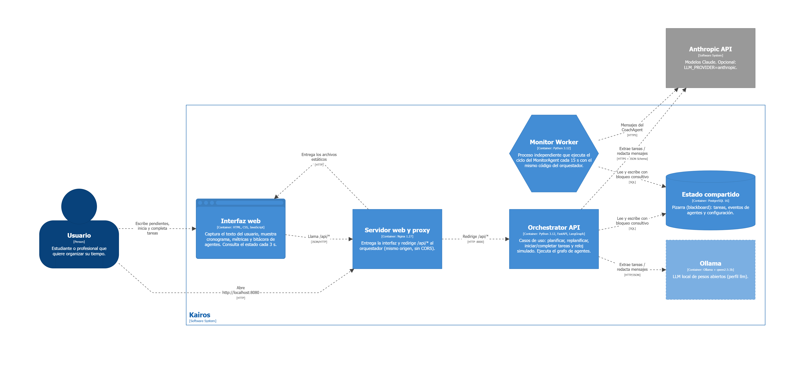

Los diagramas de abajo están en **Mermaid**, que GitHub dibuja automáticamente. También hay versiones en **C4-PlantUML** y UML en [`docs/diagrams/`](diagrams/), que se renderizan con `scripts/render-diagrams.ps1`.

---

## 3.1 Vista de alto nivel

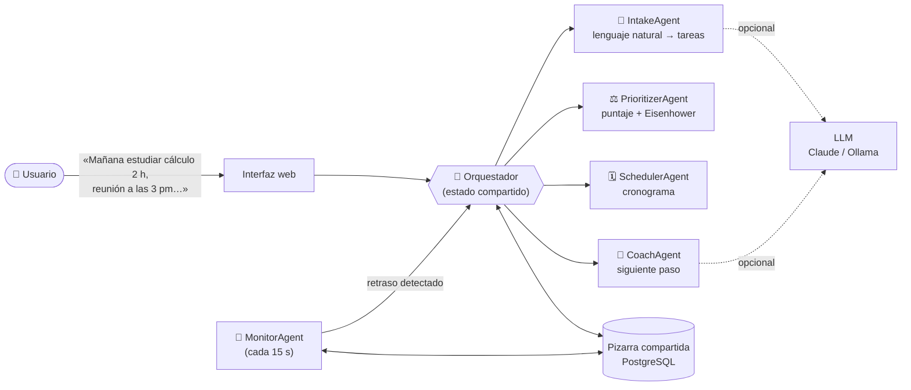

**Idea clave:** el orquestador no "piensa". **Enruta** el trabajo entre agentes especializados que leen y escriben un **estado compartido** (patrón pizarra). El LLM es opcional y solo se usa donde aporta, es decir, para entender y redactar lenguaje natural. La prioridad y la agenda son algoritmos deterministas, explicables y probados.

### Requisitos que cubre

| # | Requisito | Dónde |
|---|---|---|
| RF1 | Expresar actividades en lenguaje natural | `IntakeAgent` (LLM con esquema JSON estricto, o analizador de reglas en español) |
| RF2 | Convertirlas en tareas estructuradas (duración, categoría, importancia, fecha límite, hora fija) | `domain/models.py::Task` |
| RF3 | Priorizar | `PrioritizerAgent`: puntaje 0–100 + cuadrante de Eisenhower + explicación |
| RF4 | Organizar un cronograma | `SchedulerAgent`: jornada laboral, descansos, citas fijas, riesgo de incumplimiento |
| RF5 | Acompañar la ejecución | `CoachAgent` + acciones Iniciar / Completar |
| RF6 | Detectar retrasos | `MonitorAgent` en un contenedor `monitor` independiente |
| RF7 | Reorganizar automáticamente | Ruta `monitor → prioritize → schedule → coach` del grafo |
| RF8 | Coordinar agentes con estado compartido | `Orchestrator` + LangGraph `StateGraph` + PostgreSQL |

---

## 3.2 C4 — Nivel 1: Contexto

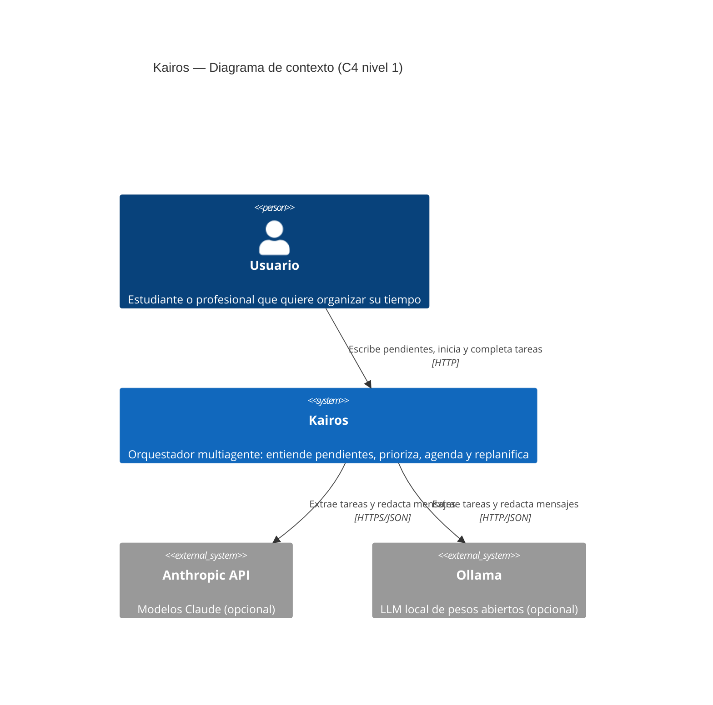

---

## 3.3 C4 — Nivel 2: Contenedores

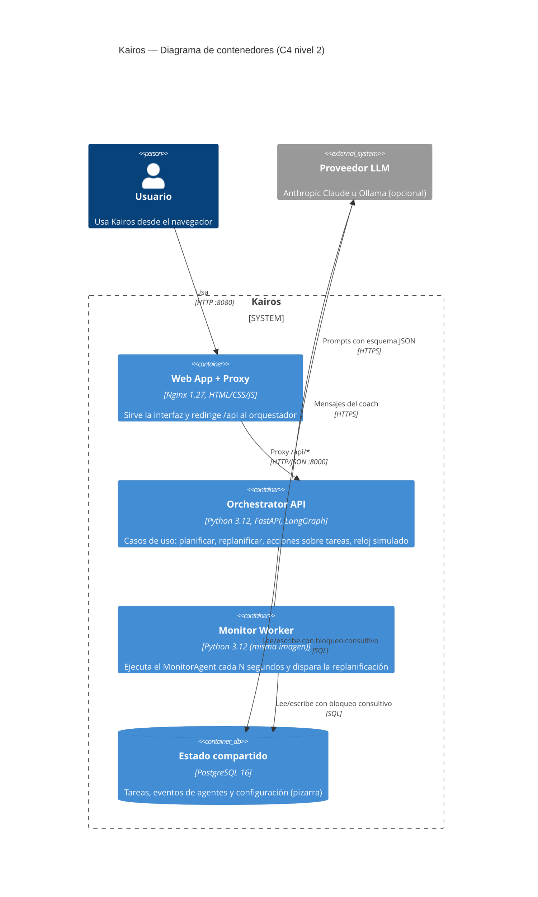

| Contenedor | Imagen | Puerto | Red | Responsabilidad |
|---|---|---|---|---|
| `web` | `kairos/web:1.0` (nginx:1.27-alpine) | 8080 → 80 | frontend | UI estática + proxy inverso |
| `orchestrator` | `kairos/orchestrator:1.0` (python:3.12-slim) | 8000 | frontend, backend | API REST + grafo de agentes |
| `monitor` | `kairos/orchestrator:1.0` | — | backend | Bucle del `MonitorAgent` |
| `db` | `postgres:16-alpine` | interno | backend | Estado compartido |
| `ollama` *(perfil `llm`)* | `ollama/ollama` | interno | backend | LLM local opcional |

---

## 3.4 C4 — Nivel 3: Componentes del Orchestrator API

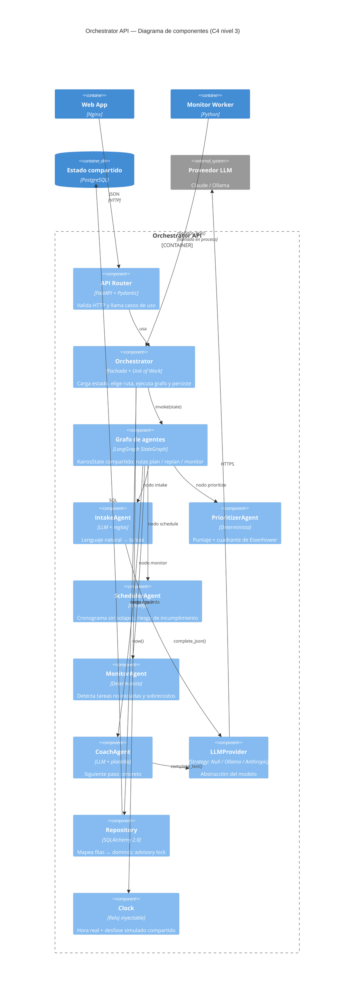

### Grafo de orquestación (LangGraph)

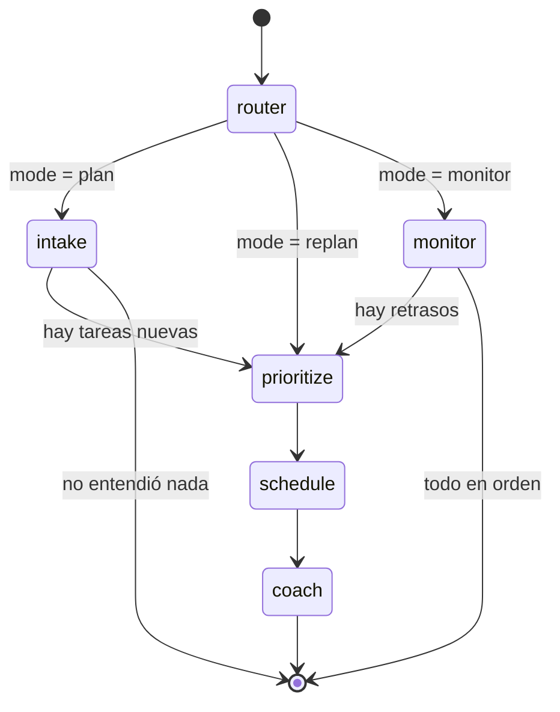

`KairosState` (estado compartido dentro del grafo):

| Campo | Tipo | Quién lo escribe |
|---|---|---|
| `mode` | `plan` \| `replan` \| `monitor` | Orquestador |
| `now` | `datetime` (reloj compartido) | Orquestador |
| `input_text` | `str` | API |
| `tasks` | `list[Task]` | Intake, Monitor, Prioritizer, Scheduler |
| `new_task_ids` | `list[str]` | Intake |
| `delays` | `list[dict]` | Monitor |
| `events` | `list[AgentEvent]` (reductor `operator.add`) | Todos (bitácora) |

---

## 3.5 C4 — Diagramas dinámicos

### a) Planificar desde lenguaje natural

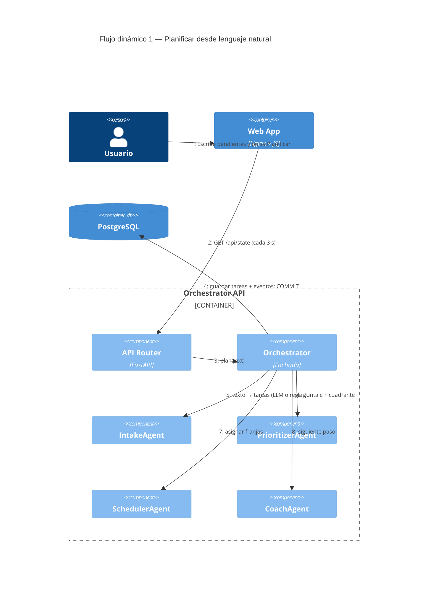

### b) Detección de retraso y replanificación automática

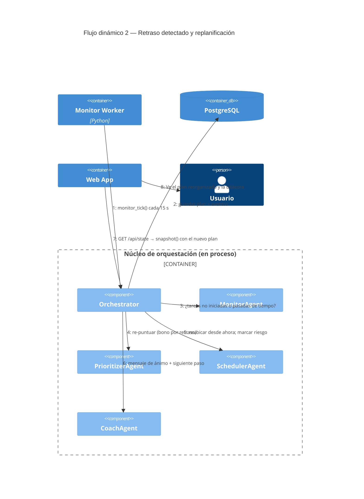

La misma interacción como diagrama de secuencia:

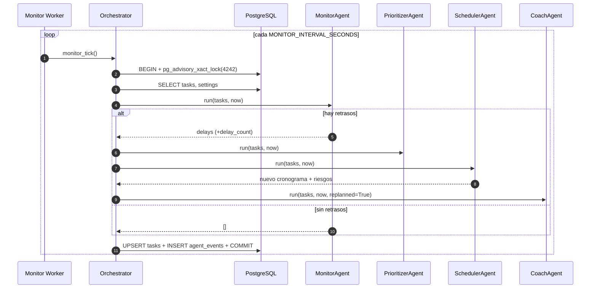

---

## 3.6 C4 — Diagrama de despliegue

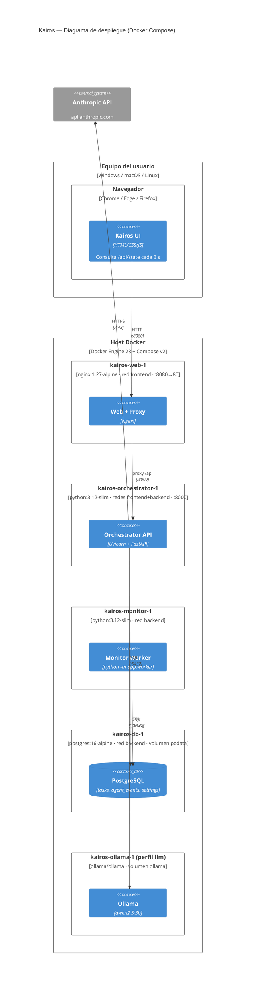

**Decisiones de despliegue**
- **Dos redes**: `frontend` (web ↔ API) y `backend` (API, monitor, BD, Ollama). La BD no queda expuesta al host.
- **Misma imagen, dos procesos**: la API y el monitor comparten código (`kairos/orchestrator:1.0`). Escalan y fallan por separado.
- **Health checks + `depends_on: condition: service_healthy`**: la API espera a la BD y la web espera a la API.
- **Volúmenes**: `pgdata` (persistencia) y `ollama` (modelos descargados).
- **Configuración 12-Factor**: todo por variables de entorno (`.env.example`).

---

## 3.7 Diagramas de paquetes UML por componente

> Mermaid no tiene diagrama de paquetes nativo. Abajo va una aproximación con subgrafos (los paquetes) y flechas punteadas «import». Los diagramas UML formales están en `docs/diagrams/paquetes-*.puml`.

### a) Componente `orchestrator` (API)

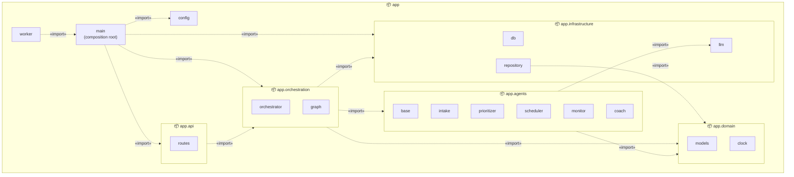

**Regla de dependencias:** `domain` no depende de nadie. `agents` solo depende de `domain` y de la abstracción `llm`. La infraestructura se conecta en `main`. Es una arquitectura por capas con el núcleo funcional al centro (estilo hexagonal ligero).

### b) Componente `monitor` (worker)

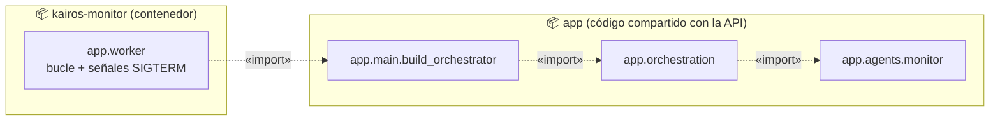

### c) Componente `web`

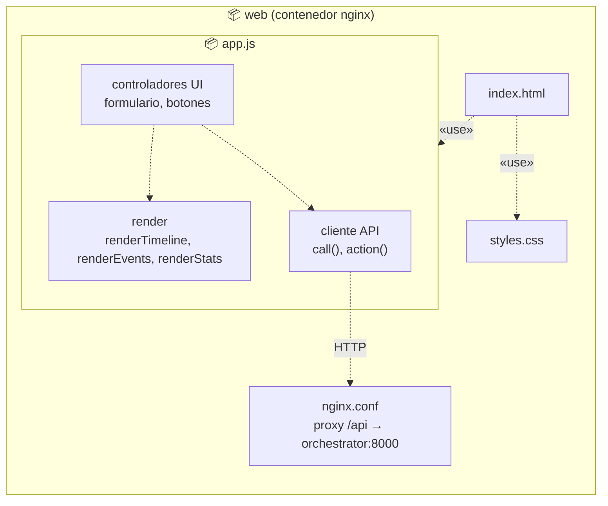

### d) Componente `db` (esquema)

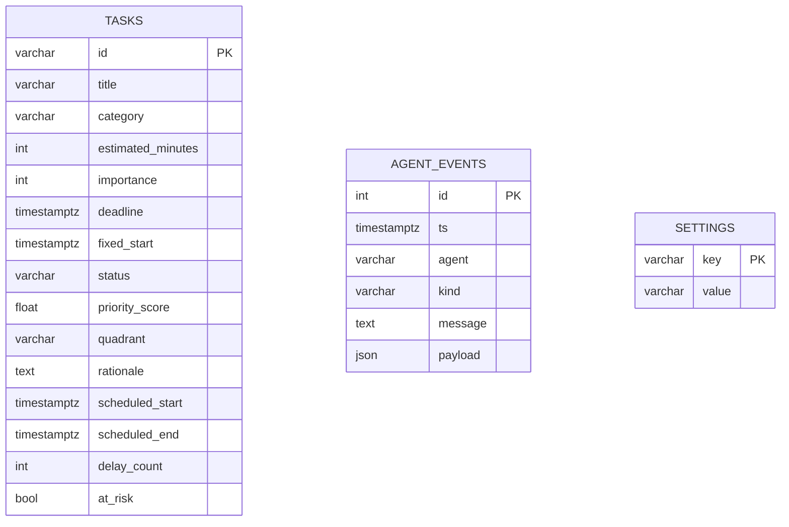

---

## 3.8 Decisiones de arquitectura (ADR resumidos)

| ADR | Decisión | Alternativas | Motivo |
|---|---|---|---|
| 001 | Agentes **en proceso**, orquestados con LangGraph | Un microservicio por agente con un bus (Kafka/RabbitMQ) | Menos latencia y operación más simple para el alcance. El grafo ya aísla responsabilidades. **Evolución**: separar agentes en servicios si crece la carga. |
| 002 | **Estado compartido en PostgreSQL** (pizarra) | Redis; memoria | Transacciones + `advisory lock` dan consistencia entre la API y el monitor. Se persiste para auditar la bitácora. |
| 003 | **LLM opcional** con degradación a reglas | Depender 100 % del LLM | Disponibilidad, costo y reproducibilidad. La demo funciona sin internet ni llaves. |
| 004 | Prioridad y agenda **deterministas** | Pedírselas al LLM | Explicables, comprobables con pruebas y sin alucinaciones aritméticas |
| 005 | **Monitor en contenedor aparte** | Tarea en segundo plano dentro de la API | Aislamiento de fallos y escalado independiente. La API sigue sin estado. |
| 006 | **Reloj con desfase compartido** | Esperar tiempo real | Permite demostrar retrasos en vivo (`+30 min`, `+2 h`) de forma reproducible |
| 007 | UI sin framework | React/Vue | El foco del curso es la arquitectura. Cero pasos de build. Las fuentes (Inter) y los íconos (Lucide) se sirven desde el contenedor, sin CDN, así que la UI funciona sin internet. Las animaciones usan una API nativa del navegador (View Transitions). |

---

## 3.9 API REST

| Método | Ruta | Descripción |
|---|---|---|
| GET | `/api/health` | Estado y proveedor de LLM |
| GET | `/api/state` | Hora (real o simulada), tareas, eventos y métricas |
| POST | `/api/plan` | `{text}` → ruta `plan` |
| POST | `/api/replan` | Ruta `replan` |
| POST | `/api/tasks/{id}/start` · `/complete` | Acción + replanificación |
| DELETE | `/api/tasks/{id}` | Eliminar tarea |
| POST | `/api/clock/advance` | `{minutes}`: simula el paso del tiempo y fuerza un ciclo del monitor |
| PUT | `/api/settings` | Jornada laboral y descansos |
| POST | `/api/reset` | Borra todo (demo) |

Documentación interactiva (Swagger): `http://localhost:8000/docs`.
